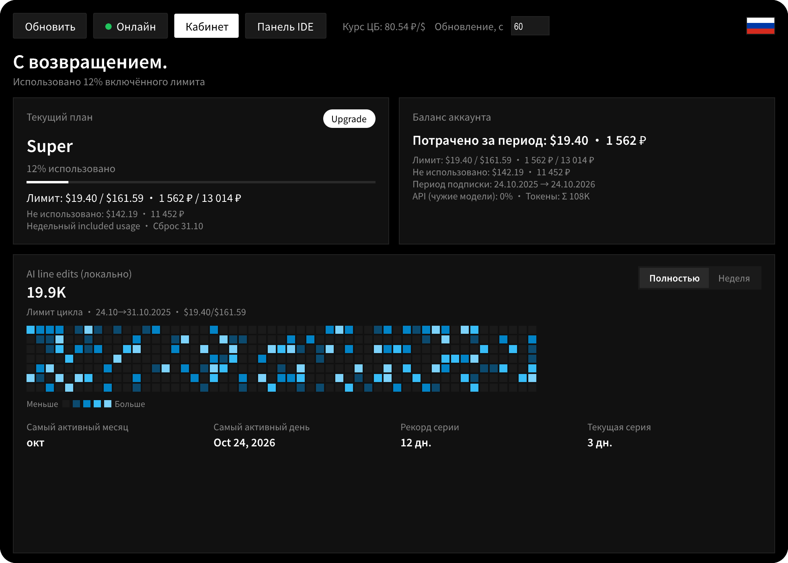
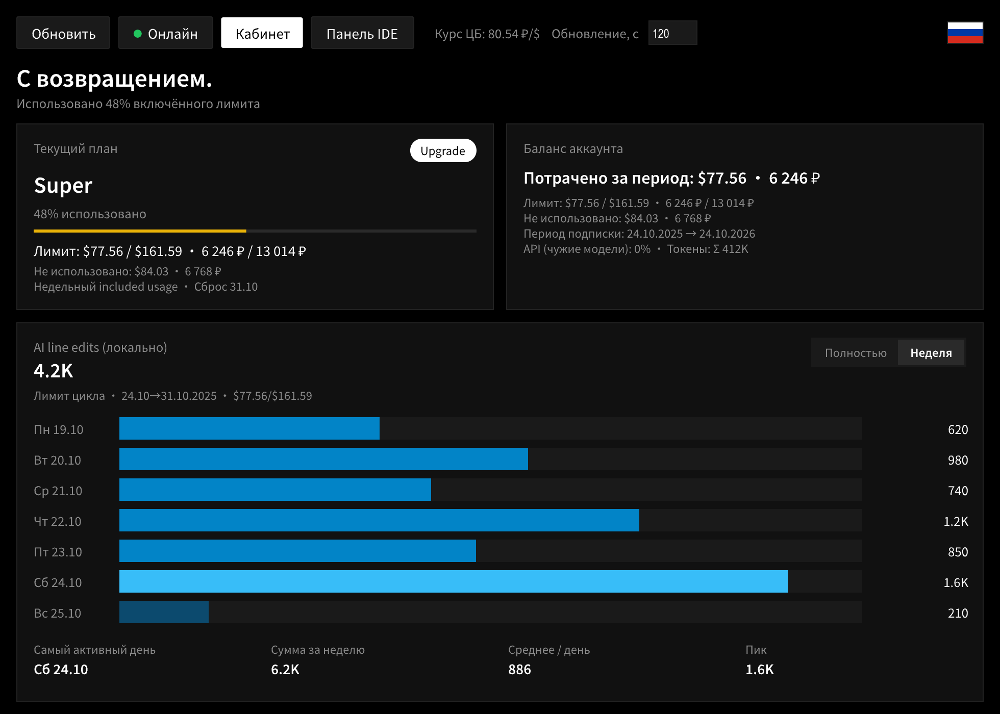
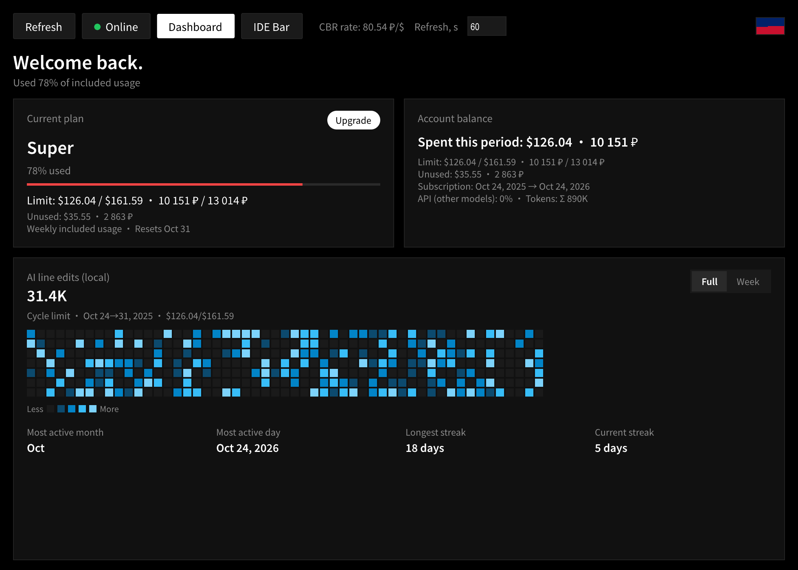

<p align="center">
  
</p>

<h1 align="center">Cursor Limits</h1>

<p align="center">
  <strong>Cursor usage limits in the Windows system tray and the IDE status bar</strong><br>
  <sub>$ · ₽ (CBR FX) · weekly pool · activity heatmap · RU / EN</sub>
</p>

<p align="center">
  <a href="./README.md">🇷🇺 Русский</a>
  ·
  <a href="./README.en.md"><strong>🇬🇧 English</strong></a>
</p>

<p align="center">
  <a href="https://github.com/EvgenyPS/cursor-limit"></a>
  
  
  
  
</p>

---

> [!IMPORTANT]
> This project uses **unofficial** Cursor APIs and is **not affiliated** with Cursor Inc.  
> Endpoints and responses may change; some regions receive `403` from parts of the API.

## Features

| | |
|---|---|
| **Tray + dashboard** | Notification-area icon and an LK-style window: plan, balance, progress |
| **Dual currency** | Limits and spend in **$** and **₽** via the Central Bank of Russia FX rate |
| **Cycle & week** | Included / weekly usage, remaining budget, days until reset |
| **Activity** | Yearly heatmap (local AI line edits) and a compact per-day week view |
| **IDE status bar** | Bottom-bar string in Cursor with **no token** and **no network** |
| **i18n** | RU / EN, flag control in the header, persisted in `settings.json` |
| **Polling** | Refresh interval **60–3600 s**, optional Windows autostart |

## Screenshots

UI mockups for documentation (figures are demo data, not from a live account).

<table>
  <tr>
    <td align="center" width="33%">
      <a href="docs/images/window-full-ru.png">
        
      </a>
      <br><sub><b>Dashboard · Full</b> · RU · ~12%</sub>
    </td>
    <td align="center" width="33%">
      <a href="docs/images/window-week-ru.png">
        
      </a>
      <br><sub><b>Dashboard · Week</b> · RU · ~48%</sub>
    </td>
    <td align="center" width="33%">
      <a href="docs/images/window-full-en.png">
        
      </a>
      <br><sub><b>Dashboard · Full</b> · EN · ~78%</sub>
    </td>
  </tr>
</table>

<details>
<summary>Open larger screenshots</summary>

#### Dashboard · Full tab (RU)


#### Dashboard · Week tab (RU)


#### Dashboard · Full (EN), high usage


</details>

## Download

<p>
  <a href="https://github.com/EvgenyPS/cursor-limit/releases/latest">
    
  </a>
</p>

Prebuilt binaries (no Python install needed):

| OS | File in [Releases](https://github.com/EvgenyPS/cursor-limit/releases/latest) |
|----|-------------------------------------------------------------------------------|
| Windows x64 | `CursorLimits-windows-x64.exe` |
| Linux x64 | `CursorLimits-linux-x64` |
| macOS Apple Silicon (M1/M2/M3/M4) | `CursorLimits-macos-arm64.app.zip` |
| macOS Intel | from source: `python -m src` |

1. Download the file for your OS and run it (on macOS, unzip the `.zip` first)
2. The OS may warn about an unsigned app (SmartScreen / Gatekeeper) — expected
3. Requires a signed-in **Cursor IDE** on this machine
4. Optional: tray → **Start at login**; **IDE Bar** for the status bar

> Linux: needs a graphical session with status notifier / AppIndicator support.

## Architecture

```text
┌─────────────────────┐     accessToken (RAM)     ┌──────────────────────┐
│  Cursor IDE         │ ─────────────────────────►│  Cursor Limits (tray) │
│  state.vscdb        │                           │  Python · pystray     │
└─────────────────────┘                           └──────────┬───────────┘
                                                             │
                    ┌────────────────────────────────────────┼────────────────┐
                    ▼                                        ▼                ▼
           cursor.com / api2                    cbr-xml-daily.ru     ~/.cursor-limits/
           (usage / billing)                    (USD → RUB)          cache.json
                                                                             │
                                                                             ▼
                                                                  cursor-status-bar
                                                                  (cache read-only)
```

**Security model:** the session token is read from Cursor’s local SQLite and is **never written** to disk by this app. Only usage aggregates go into the cache and the extension. Details: [docs/SECURITY.md](docs/SECURITY.md).

## Quick start

### Requirements

- Windows 10 / 11  
- Python **3.12+**  
- Cursor IDE installed and **signed in** on this machine  

### Install from source

```powershell
git clone https://github.com/EvgenyPS/cursor-limit.git
cd cursor-limit

python -m venv .venv
.\.venv\Scripts\pip install -r requirements.txt
.\.venv\Scripts\python.exe -m src
```

After launch, the icon appears in the system tray. Left / right click opens the dashboard and menu.

### Build `.exe`

```powershell
powershell -ExecutionPolicy Bypass -File .\scripts\build-exe.ps1
.\dist\CursorLimits.exe
```

Autostart: tray context menu → **Start with Windows** (HKCU `\Software\Microsoft\Windows\CurrentVersion\Run`).

## Cursor status bar

The extension is copied to `%USERPROFILE%\.cursor\extensions\` and reads  
`%USERPROFILE%\.cursor-limits\cache.json` — **no token, no network**.

| Method | Action |
|--------|--------|
| From UI | **IDE Bar** button in the dashboard or tray menu item |
| CLI | `python -m src --install-statusbar` |
| Script | `powershell -ExecutionPolicy Bypass -File .\scripts\install-status-bar.ps1` |

Then in Cursor: `Ctrl+Shift+P` → **Developer: Reload Window**.

**Line format:**

```text
● 12% · $12.66 · 1 020 ₽ · 3d · today 1.2K
```

| Part | Meaning |
|------|---------|
| `●` | Color by weekly %: green → yellow → red (≈ 0–50 / 50–85 / 85–100) |
| `%` / `$` / `₽` | Usage and spend for the current cycle |
| `Nd` | Days until reset |
| `today` | Tokens / activity for today |
| hover | Week days: `# · day · tokens · $ · ₽` |

## Settings

| Setting | Where |
|---------|--------|
| Language RU / EN | Flag in the window header or tray menu |
| Poll interval 60–3600 s | Spinbox in the header |
| Settings file | `%USERPROFILE%\.cursor-limits\settings.json` |
| Usage cache | `%USERPROFILE%\.cursor-limits\cache.json` |

Optional fallback token (not recommended): copy `.env.example` → `.env`.  
Preferred path: session credentials from the Cursor IDE.

## CLI

```powershell
python -m src                      # tray (main mode)
python -m src --once               # one snapshot → cache
python -m src --status-bar         # status-bar line
python -m src --print-cache        # dump cache
python -m src --online-check       # probe endpoints
python -m src --install-statusbar  # install extension
python -m src --install-autostart  # Windows autostart
python -m src --uninstall-autostart
```

## Repository layout

```text
cursor-limits-app/
├── src/                  # auth, API, service, tray, i18n, icon
├── cursor-status-bar/    # Cursor bottom-bar extension
├── scripts/              # build-exe.ps1, install-status-bar.ps1
├── docs/
│   ├── images/           # README screenshots
│   ├── SETUP.md          # install & troubleshooting (RU)
│   └── SECURITY.md       # threat model & pre-push checklist (RU)
├── cursor-ico.svg        # tray icon source
├── README.md             # Russian
├── README.en.md          # this page (EN)
└── LICENSE               # PolyForm Noncommercial 1.0.0
```

## Documentation

| Doc | Contents |
|-----|----------|
| [docs/SETUP.md](docs/SETUP.md) | Install paths & troubleshooting (Russian) |
| [docs/SECURITY.md](docs/SECURITY.md) | Auth, cache, what not to commit (Russian) |
| [README.md](README.md) | Русская версия |

## Limitations & disclaimer

- Cursor APIs are unofficial: they may break or return `403` by region.  
  Working source for `$` / `₽` is `usage-summary`; some `api2` / dashboard POSTs are often blocked in RU.  
- Under a region block, the activity calendar falls back to **local** `ai-tracking`.  
- Do not publish `.env`, `cache.json`, or screenshots that expose account PII.  
- Use at your own risk; authors are not liable for account action or API changes.

## License

[PolyForm Noncommercial License 1.0.0](LICENSE) © 2026 [EvgenyPS](https://github.com/EvgenyPS)

This is **source-available for noncommercial use** (not OSI “Open Source” — commercial use is restricted).

| Allowed | Not allowed |
|---------|-------------|
| Personal / educational / noncommercial use | Selling the app or products based on it |
| Study, modify, fork for noncommercial purposes | Paid SaaS, paid builds, commercial resale |
| Redistribute while keeping the license and attribution | Removing copyright / `Required Notice` |

**Required attribution** when redistributing or creating derivatives:

`Required Notice: Copyright (c) 2026 EvgenyPS — https://github.com/EvgenyPS/cursor-limit`

Full text: [LICENSE](LICENSE) · [polyformproject.org](https://polyformproject.org/licenses/noncommercial/1.0.0/)

---

<p align="center">
  <a href="./README.md">🇷🇺 Русский</a>
  ·
  <a href="./README.en.md"><strong>🇬🇧 English</strong></a>
</p>
